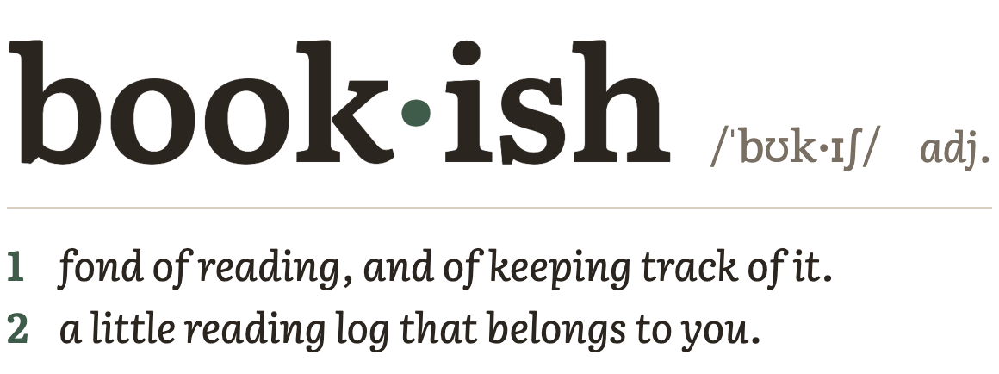

<p align="center">
  <picture>
    <source media="(prefers-color-scheme: dark)" srcset="docs/logo-dark.png">
    
  </picture>
</p>

i used to keep track of what i read in a spreadsheet. title, author, start/end dates, and a few notes. it worked, but it was clunky and ugly.

so this is the app version. i built it for myself, and it only does the tracking part, keeping tabs on:

- what i'm reading, with how many days in
- up next: the top five books that i want to read next, taken from the longer queue
- the queue: everything i might read someday, plus the books i didn't finish in case i want another go
- what i thought: one note per book, written when i'm done reading
- kindle highlights, pulled in from the `My Clippings.txt` file on the kindle
- stats for the year: how many, by month, quickest and longest

it works offline (so you can update in the subway), installs to the home screen, and looks like paper.

**try it at [readingis.cool](https://readingis.cool)**

## what it doesn't do

no recommendations, no discovery, no ratings, no social stuff, no covers, no looking anything up on the internet. it doesn't know what you should read next and it doesn't try to.

## your data

there are no accounts. your library lives at a long private link, and that link is the key, so anyone who has it can read and change that library. keep it somewhere safe.

everything exports from settings as json (all of it, and it can be restored), csv, or markdown. you can also import a spreadsheet with title, author, start, end and notes columns, one sheet per year.

## running your own

you'll need node and a free firebase project (firestore + hosting, no billing).

```bash
npm install
npm run dev
```

to put it online:

1. create a firebase project, add a web app, and create a firestore database
2. put your project's web config in `src/firebase.ts` (the second, private branch) and your project id as `default` in `.firebaserc`
3. `npm run deploy`

`npm test` runs the tests for the parts that matter (imports, dates, the queue, stats).

## built with

react, vite and typescript, plain css, firebase (firestore and hosting), and [literata](https://github.com/googlefonts/literata) for the type.

## license

[MIT](LICENSE)
